📍 Vijayawada, India &nbsp;·&nbsp; 🎓 CGPA 9.27 / 10 &nbsp;·&nbsp; 🟢 Open to 2027 internships & full-time roles
  

---

### 🧠 About me

- 🎓 Final-year CSE student specialising in **AI/ML**, focused on deep learning, NLP and LLM systems.
- 🔬 Was a **Research Intern @ SRM University AP** (Jun – Aug 2025) — built an end-to-end **RAG** pipeline (Sentence-Transformers retrieval + Flan-T5 generation, FAISS) for question answering on SQuAD.
- 🩻 Built a **cross-scanner ACL tear detection** system from knee MRI using multi-view deep learning (Val AUC 0.954), completed in April 2026.
- 🛠️ I like taking a model all the way: data → training → explainability → a REST API someone can actually call.
- 🎯 **Open to** ML/AI Engineer, SDE, and Solutions Engineer roles — 6-month internships and full-time (2027).
- 📜 Oracle Certified **Java SE 17** Developer.

---

### 🚀 Featured projects

<table>
<tr>
<td width="50%" valign="top">

#### 🩻 [ACL Injury Detection](https://github.com/gkarthik04/ACL-Injury-Detection)
Multi-view ResNet-18 with slice attention on 3-plane knee MRI (MRNet). Grad-CAM++ explainability, Flask API and Docker.

**Val AUC 0.954 · Acc 93.3% · Sens 94.4%**

`PyTorch` `OpenCV` `Flask` `Docker`

</td>
<td width="50%" valign="top">

#### 🏥 [DischargeAssist AI](https://github.com/gkarthik04/DischargeAssist-AI)
GenAI pipeline that turns raw clinical notes into SOAP notes, medication explanations, follow-ups and plain-language patient summaries, with readability and confidence scoring.

`FastAPI` `Gemini` `Pydantic` `SQLite`

</td>
</tr>
<tr>
<td width="50%" valign="top">

#### 🎣 [Phishing Website Detection](https://github.com/gkarthik04/Phishing-Website-Detection)
Real-time URL classifier comparing LR, KNN, SVM and Random Forest on 11k sites; SHAP explanations served to a web dashboard.

**Random Forest · 96.6% accuracy**

`scikit-learn` `SHAP` `Python REST API`

</td>
<td width="50%" valign="top">

#### 💳 [Razorpay Payments Integration](https://github.com/gkarthik04/razorpay-flask-demo)
End-to-end Razorpay Standard Checkout in test mode: Orders API, HMAC-SHA256 signature verification and an idempotent, signature-checked webhook receiver. Unit-tested.

`Flask` `Razorpay API` `Webhooks` `pytest`

</td>
</tr>
</table>

More of my coursework lives in [Machine-Learning](https://github.com/gkarthik04/Machine-Learning) — NumPy, pandas, feature engineering, regression, Naive Bayes.

---

### 🧰 Tech stack

**Languages**

  

**ML / AI** &nbsp; PyTorch · scikit-learn · Hugging Face Transformers · Sentence-Transformers · FAISS · OpenCV · SHAP · NLP · RAG

**Backend & tools**

  

**Foundations** &nbsp; Data Structures & Algorithms · Object-Oriented Design · REST API design · Operating Systems

---

Always happy to talk about ML systems, research ideas or internship opportunities — reach me on <a href="https://linkedin.com/in/g-sai-karthikeya/">LinkedIn</a> or by <a href="mailto:gkarthikeya2005@gmail.com">email</a>.

